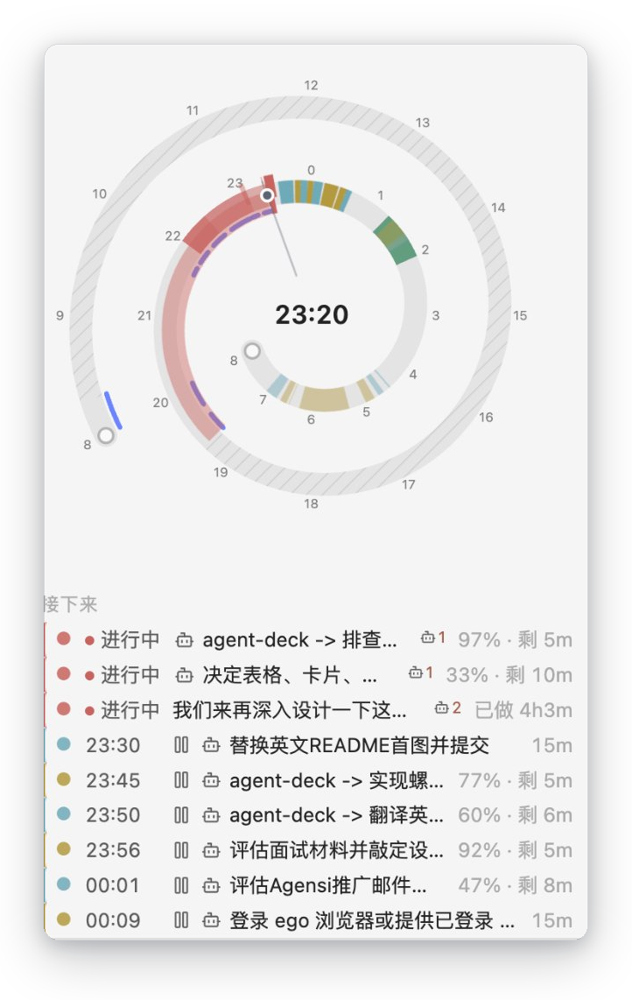

# 螺旋日程 Nautilus Spiral

> **给每一分钟安排一份工作。**

一个由日记驱动的 Obsidian 螺旋日计划。

**简体中文** · [English](./README.en.md) · [使用指南](./docs/guide.zh-CN.md)

<p align="center">
  
</p>

把今天日记里的事件和待办画成一圈螺旋：固定事件钉在它的时刻上，待办按顺序和预计时长，从「现在」开始自动填进空档。时间往前走，没做完的任务跟着往后流；排不下的，当场告诉你缺多少。

50 秒看完它做什么（有声音）：

https://github.com/user-attachments/assets/1e0967bc-d498-456a-9d82-46750d761c08

界面跟着 Obsidian 的语言自动切换中文或英文。

---

## 它有什么功能

### 螺旋日计划与容量一眼看清
- **12 小时螺旋表盘**：最外圈是一天的开始，最里圈是结束。固定事件、排进去的待办、已完成的任务和「现在」指针都在上面，鼠标划过即看详情。
- **自动排程与容量预算**：在日记里写时间和待办，插件自动把待办填进事件之间的空档，并实时算出已计划时长、余量 / 超载与剩余百分比。
- **主线任务（`[#A]`）**：每天最多标记 3 块主线，优先排程、独立着色，并在顶部一眼看清完成进度。
- **未记录时间与一键回放**：已经过去但没留下记录的时段以斜纹标出；点顶部播放按钮可在 6 秒内回放一整天的推进过程。
- **自动计时与复盘**：任务切到 `DOING` 自动计时，支持当日复盘（预计 vs 实际）与近 30 天预估校准，右下角状态栏常驻显示当前计时或容量。
- **只读日历同步**：可选接入 macOS 日历或 Google 日历，将日历日程作为固定事件自动排入螺旋。
- **柔和动效与状态音效**：点击交互与任务状态切换配有轻柔合成音效（可在设置中关闭）。

### 番茄钟与「接下来」快捷操作
- **轻量化番茄钟（`15m` / `25m` / `自定义`）**：在「今天」的容量区下方切换三档时长，点击播放图标即可开启——可以独立预订接下来的一段时间，也可以从任务右键启动（自动切为 `DOING`，到点弹窗可选标为 `DONE`、再来一轮或收工）。
- **螺旋外沿可视化预订**：进行中的番茄钟画在主轨外沿，**已兑现部分画实线、尚未实现的预订部分画虚线并在预计结束处标空心圆点**，不挤占原有排程；完成的轮次以淡色细弧留痕。
- **「接下来」快速切状态与重要程度**：左键点状态圆点可在 `DONE → SUSPENDED → 原状态` 间一键循环；右键菜单可直接切换人工状态（`TODO` / `DOING` / `DONE` / `PAUSED` / `WAITING` / `SUSPENDED` / `CANCELLED`）、设置重要程度（`[#A]` / `[#B]` / `[#C]` / 清除）或直接用番茄钟开始。

<p align="center">
  
  
</p>

---

## 快速开始：安装与使用

### 1. 安装
- **社区市场 / BRAT**：在 Obsidian 插件市场搜索 **Nautilus Spiral**，或通过 BRAT 添加仓库 `MatsuriMW/nautilus-spiral` 安装并启用。
- **手动安装**：从 [Releases](https://github.com/MatsuriMW/nautilus-spiral/releases/latest) 下载 `main.js`、`manifest.json`、`styles.css`，放入库的 `.obsidian/plugins/nautilus-spiral/` 目录并在 Obsidian 设置中启用。

### 2. 开箱即用
- 首次启用后，插件会自动在**左侧栏**打开螺旋视图，并自动识别 Obsidian 的「日记」目录与日期格式（如需自定义，可在插件设置里手动修改）。
- 如果今天还没有日记，打开螺旋面板时会自动为你建好。

### 3. 在今天的日记里这样写
直接用普通列表记录事件和待办，螺旋会实时跟着更新：

```markdown
- 14:00-15:00 团队周会
- TODO [#A] 完成方案初稿 45m
- TODO 回复邮件 15m
- DOING 整理需求文档 30m
```

- **固定事件**：写上时间段（如 `14:00-15:00` 或 `下午3点到4点`）就会钉在对应位置。
- **待办与时长**：用 `TODO` / `DOING` / `DONE`（或复选框 `[ ]` / `[/]` / `[x]`），写上预计时长（`15m`、`半小时`、`1.5h`）；没写时按默认时长估算。
- **标记主线**：给最要紧的 1–3 件事加上 `[#A]`（或简写 `todo a`），也可以在「接下来」列表里右键设置重要程度。
- **随时微调当天作息**：拖动螺旋两端的空心圆把手，或点击顶部 `☀️--:--–🌙--:--`，即可按今天实际的起床和收工时间重算容量。

> 所有命令均不预设全局快捷键，需要时可在 Obsidian「设置 → 快捷键」中搜索「螺旋日程」自行绑定。更多细节请参阅 [使用指南](./docs/guide.zh-CN.md)。

---

## 与 Agent Deck 联动

只装螺旋日程就是一套完整的个人日程与番茄钟工具；再装上 [Agent Deck](https://github.com/MatsuriMW/obsidian-agent-deck) 后，你的日记大纲会变成所有 AI Agent 的统一工作台：

<p align="center">
  
</p>

- **自动记录 AI 工作轨迹**：Agent Deck 负责把 Claude Code、Codex、WorkBuddy、DeepSeek Harness、Antigravity 等会话自动写进日记，更新运行状态、对话轮次、结论摘要和归档完成。
- **螺旋内圈可视化呈现**：螺旋日程把各个 Agent 的活跃时段按不同颜色画在螺旋内圈，在容量区汇总人机协作时长与 token 消耗。
- **状态色实时同步**：螺旋块与「接下来」列表会自动同步 Agent 的实时状态（运行中、待检视、等你允许、排队、限额、出错），点开任务旁的 AI 徽章可直接查看关联会话并跳转回去。
- **同一套日界标准**：两者共用螺旋日程的每日分界时间，深夜加班的会话也能准确归入当天。

---

## 反馈与后续

后续规划与功能需求整理在 [Roadmap](https://matsuri.site/portfolio/journal-workflow/#whistlist)，欢迎提出建议或为你想要的功能投票。也可以在 Twitter 上关注进展与反馈问题：[@Matsurimywaifu](https://x.com/Matsurimywaifu)。

MIT License.
