<div align="center">

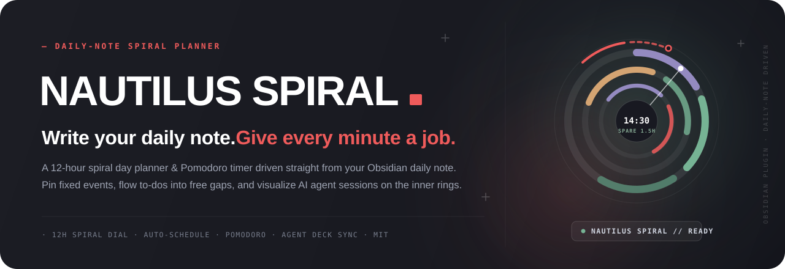

<br />

**English** · [简体中文](README.zh-CN.md)

[](LICENSE)
[](https://github.com/MatsuriMW/nautilus-spiral/releases)

[**Install**](#quick-start-install--use) · [What's New](#whats-new) · [User Guide](./docs/guide.md) · [Works with Agent Deck](#works-with-agent-deck) · [Roadmap](https://matsuri.site/portfolio/journal-workflow/#wishlist) · [X (@Matsurimywaifu)](https://x.com/Matsurimywaifu)

</div>

<p align="center">
  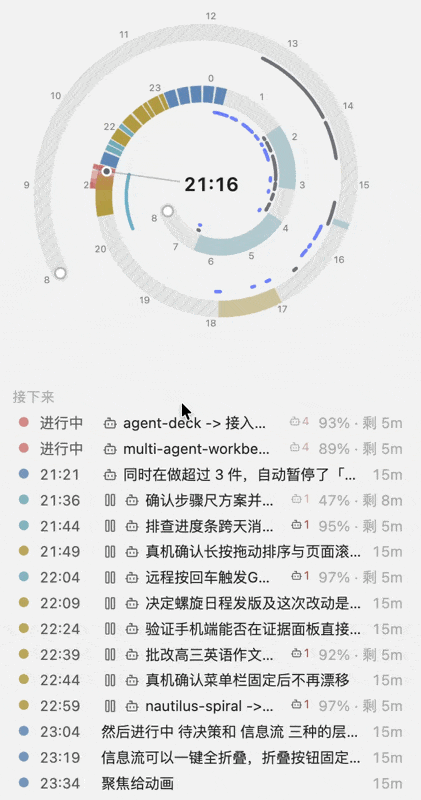
</p>

Turn today's daily note into a spiral timeline: fixed events stay pinned to their times, and to-dos flow automatically from "now" into the free gaps by list order and estimated duration. As the day moves on, unfinished tasks shift forward and the capacity bar tells you at a glance whether today still fits.

A 50-second tour (Chinese captions, with sound):

https://github.com/user-attachments/assets/c1ccdeaf-1e4b-4798-bcfd-d04401101979

The interface switches automatically between English and Chinese based on Obsidian's language setting.

## Contents

- [What's New](#whats-new)
- [What It Does](#what-it-does)
- [Quick Start: Install & Use](#quick-start-install--use)
- [Works with Agent Deck](#works-with-agent-deck)
- [Feedback & Updates](#feedback--updates)

---

## What's New

Recent updates (v2.6.8–v2.6.19) introduce **outer spiral callout labels**, **interactive segment & unrecorded-gap inspection**, a **compact schedule & label toolbar**, **embedded daily spirals** (`nautilus-spiral` code blocks), a **reorganized 4-tab settings panel**, a **bilingual interactive example & guide note**, and a **6-dimensional Spiral Review dashboard** (Day / Week / Month).

- **Outer spiral callout labels**: Two-line detail cards and compact contour-aligned labels automatically stack along the spiral rim—or drop below the dial for lower-arc blocks—to stay collision-free even on dense multi-agent days.
- **Hover-linked inspection**: Hovering any task arc or hatched unrecorded gap highlights its leader line and reveals the exact time span, duration, and project summary in the top bar.
- **Unified sidebar & 6-dimensional review**: Toggle outer labels or switch custom schedule presets from the header toolbar, track combined human + AI collaboration time and tokens, and review estimation accuracy, time bills, 8-week calibration trends, 24-hour rhythms, and multi-day rollovers—or hand the review straight to your primary AI agent.

<table>
  <tr>
    <td align="center" width="50%">
      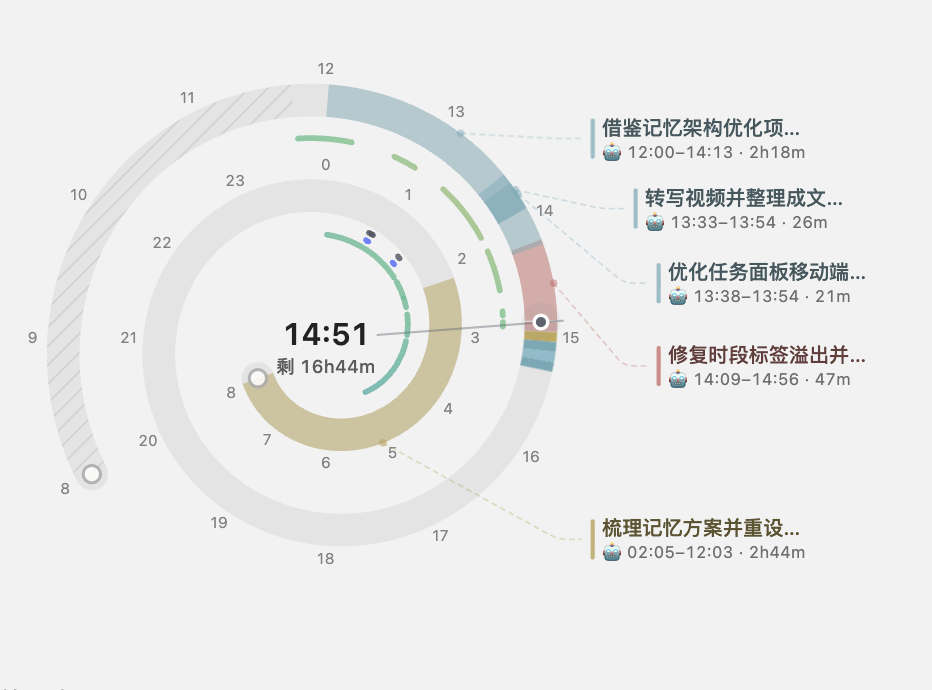
      <br />
      <sub><b>Two-line outer label cards</b> — time span, duration, and status color at a glance</sub>
    </td>
    <td align="center" width="50%">
      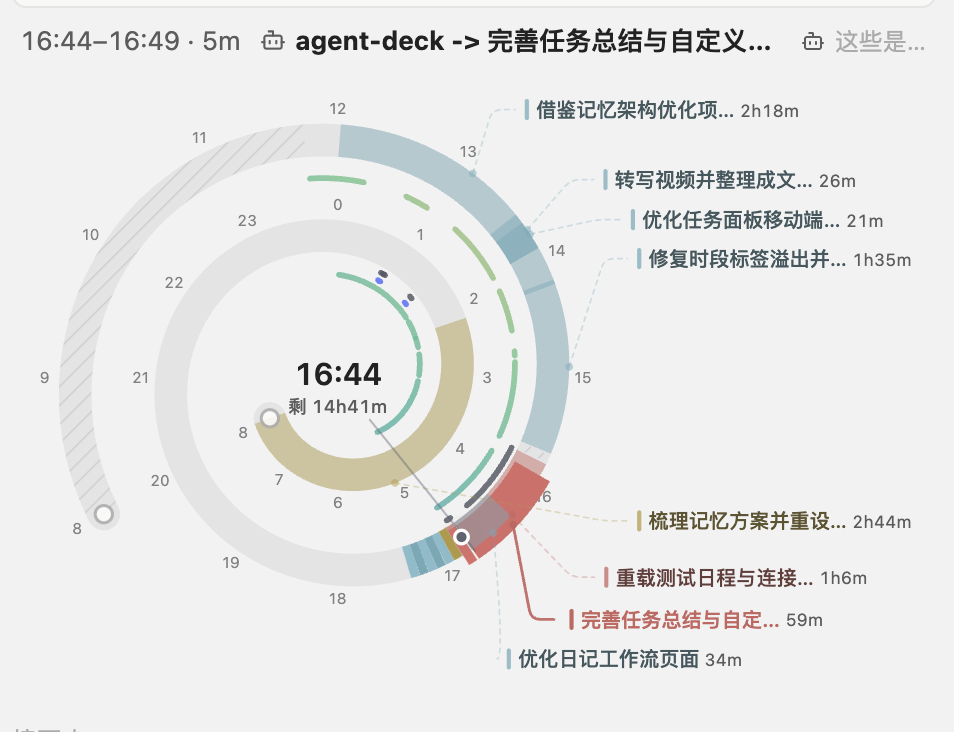
      <br />
      <sub><b>Hover-linked highlighting</b> — active arc, solid leader line, and top inspection bar</sub>
    </td>
  </tr>
  <tr>
    <td align="center" width="50%">
      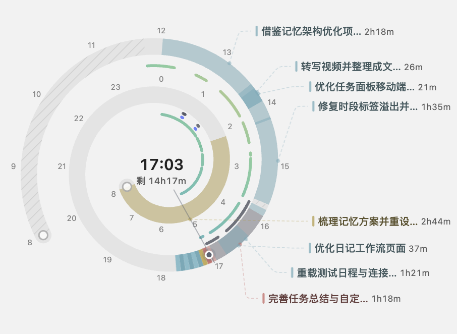
      <br />
      <sub><b>Contour-aligned compact labels</b> — collision-free stacking on busy multi-session days</sub>
    </td>
    <td align="center" width="50%">
      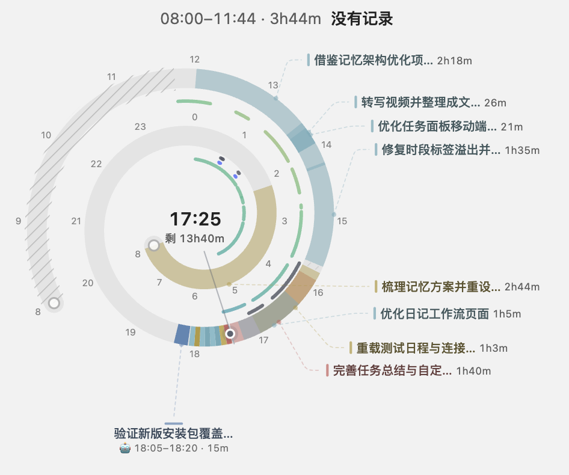
      <br />
      <sub><b>Unrecorded-gap inspection &amp; bottom callouts</b> — adaptive label placement below the dial</sub>
    </td>
  </tr>
</table>

<p align="center">
  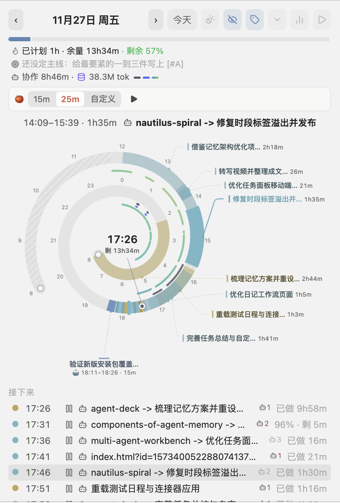
</p>
<p align="center"><b>Refreshed sidebar view</b> — compact schedule &amp; label controls, live AI collaboration totals, Pomodoro bar, and unified "Up next" list.</p>

<p align="center">
  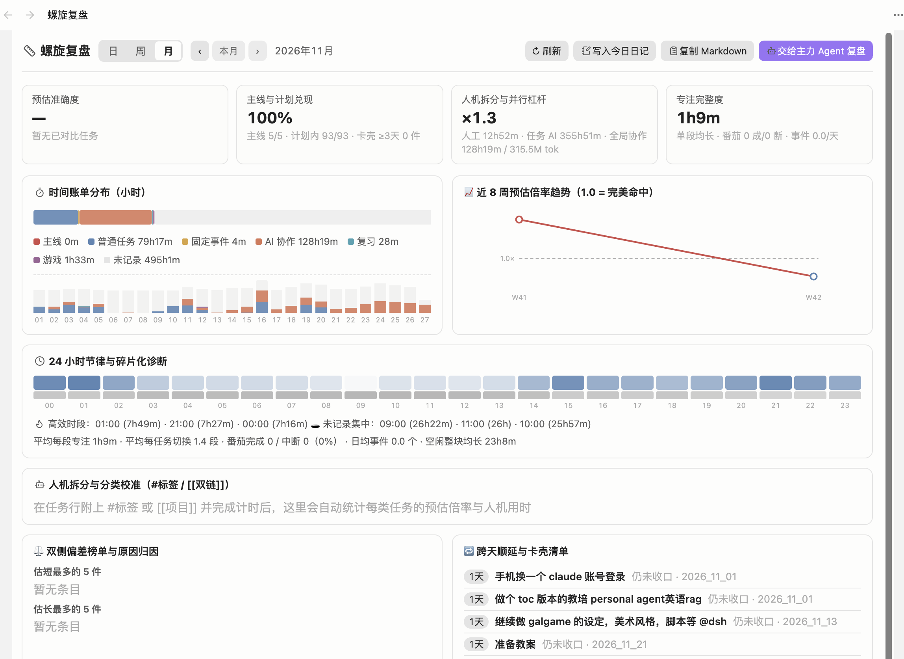
</p>
<p align="center"><b>6-dimensional Spiral Review</b> — Day / Week / Month analytics for time distribution, 8-week estimate calibration, 24-hour rhythm, human-AI leverage, and one-click journal writeback or AI agent review.</p>

---

## What It Does

### Spiral Day Planner & Capacity at a Glance
- **12-hour spiral dial**: The outer ring starts your day and spirals inward to the end. Fixed events, scheduled to-dos, completed blocks, and the "now" pointer live on one view—hover any segment for instant details.
- **Automatic scheduling & time budget**: Write events and to-dos in your daily note and let Nautilus Spiral place them into free gaps, continuously showing planned time, spare/overload, and remaining percentage.
- **Mainline tasks (`[#A]`) & priority badges**: Mark up to 3 top-priority blocks a day to schedule them first and track progress at the top; `[#A]` / `[#B]` / `[#C]` (and fuzzy shortcuts like `todo a`, `todoa`, `[ ] b`, `DOING 14:05 a`, or `- a` under `todos:`) auto-normalize on line leave and render as red `A` / amber `B` / blue `C` square badges in both the editor and the spiral sidebar.
- **Unrecorded time & day playback**: Past stretches with no records appear hatched; click Play in the header to replay the whole day in 6 seconds without touching your note.
- **Automatic timing & reviews**: Switching a task to `DOING` starts timing automatically, feeding today's plan-vs-actual review, a 30-day estimate calibration, and a status bar indicator.
- **Read-only calendar sync**: Optionally pull events from macOS Calendar or Google Calendar into the spiral as fixed blocks.
- **Subtle motion & sound cues**: Gentle synthesized feedback on clicks and task status changes (can be muted in settings).

### Lightweight Pomodoro & Up Next Quick Actions
- **Three-preset Pomodoro (`15m` / `25m` / `Custom`)**: Right under capacity on today's view, pick a preset and click play to reserve an upcoming focus block—independently, auto-bound to your current manual `DOING` task, or linked to a specific task via right-click on a list row or spiral task segment (`🍅 Start Pomodoro` / `🍅 Start with estimate` / quick `25m` & `15m` at the top of the menu, switching to `⏹ Stop current Pomodoro` when that task is already running, plus the editor command for the task at cursor); right-clicking a fixed event row or segment offers a standalone Pomodoro without editing the note. When a round finishes (or stops early after ≥1 min), actual time is automatically written back under the task as `- ⏱ HH:MM–HH:MM · total Xm` for day review and AI planning; switching tasks settles and pauses the previous task cleanly.
- **Reserved time on the spiral**: An active Pomodoro renders on the spiral's outer rail as a **solid arc for elapsed time + dashed arc with a hollow end dot for the unrealized reservation**, without pushing scheduled tasks back, and clicking/right-clicking the outer rail jumps to the bound task or stops it; completed rounds stay as subtle arcs.
- **Fast status & priority actions**: Click a task's status dot in "Up next" to cycle `DONE → SUSPENDED → original state`; right-click tasks in "Up next", "Mainline", "Won't fit", "Parked", or directly on open task segments on the spiral to start/stop a Pomodoro, pick a human status (`TODO` / `DOING` / `DONE` / `PAUSED` / `WAITING` / `SUSPENDED` / `CANCELLED`), or set priority (`[#A]` / `[#B]` / `[#C]` / clear).

<p align="center">
  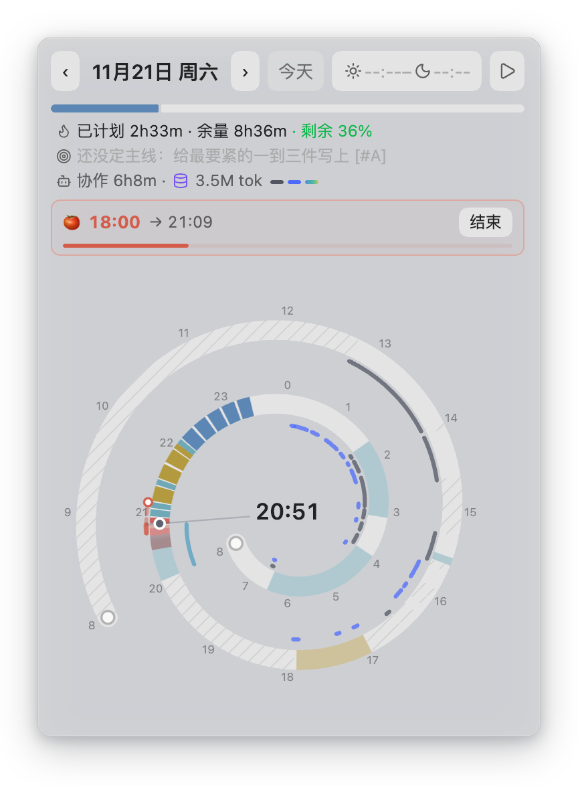
  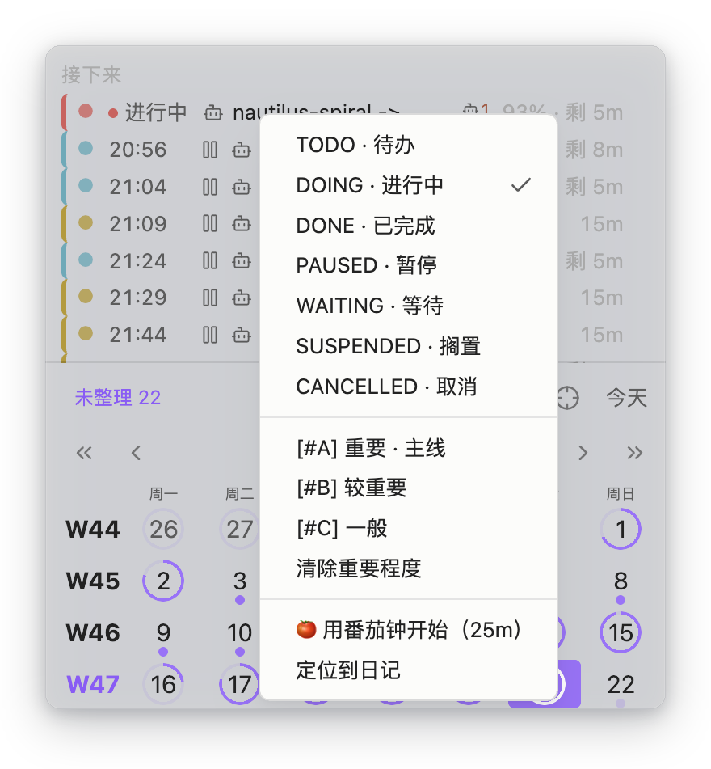
</p>

A walkthrough of Pomodoro timing, multi-segment actual-time logging, and daily review (English captions):

https://github.com/user-attachments/assets/253781c1-fbfe-43d4-9c41-cc9446c6a369

---

## Quick Start: Install & Use

### 1. Install
- **Community Plugins / BRAT**: Search for **Nautilus Spiral** in Obsidian Community Plugins, or install via BRAT using `MatsuriMW/nautilus-spiral`.
- **Manual**: Download `main.js`, `manifest.json`, and `styles.css` from the [latest release](https://github.com/MatsuriMW/nautilus-spiral/releases/latest) into `.obsidian/plugins/nautilus-spiral/` and enable it in Settings.

### 2. Ready Out of the Box
- On first enable (and on major/feature upgrades), Nautilus Spiral opens in the **left sidebar** and automatically creates & opens a bilingual example and guide note (`Nautilus Spiral/螺旋日程示例 - Nautilus Spiral Guide.md`) with copyable templates, Agent Deck pairing tips, and a summary of new features. Reopen it anytime via **Open Nautilus Spiral guide & example note** in the Command Palette.
- It automatically detects your Obsidian Daily Notes folder and date format (you can override them in settings anytime).
- If today's daily note doesn't exist yet, opening the spiral prompts or creates it according to your chosen policy.

### 3. Write in Today's Daily Note
Use regular bullet items and the spiral updates live:

```markdown
- 14:00-15:00 Team sync
- TODO [#A] Draft proposal 45m
- TODO Reply to emails 15m
- DOING Organize spec notes 30m
```

- **Fixed events**: Include a time range (e.g. `14:00-15:00`) to pin it to the spiral.
- **To-dos & estimates**: Use `TODO` / `DOING` / `DONE` (or checkboxes `[ ]` / `[/]` / `[x]`) with an estimate (`15m`, `1.5h`); tasks without one use the default duration.
- **Mainline**: Tag 1–3 key items with `[#A]` (or shorthand `todo a`), or right-click any item in "Up next" to set its priority.
- **Adjust today's hours**: Drag the hollow start/end handles on the spiral—or click the sun/moon schedule icon at the top to set today's start/end, switch presets, or customize your own. Presets act only as defaults; earlier or later entries automatically expand the spiral.

> No global hotkeys are bound by default; assign any command you want in Obsidian Settings → Hotkeys. See the [User guide](./docs/guide.md) for more details.

---

## Works with Agent Deck

On its own, Nautilus Spiral is a focused personal planner and Pomodoro tool. Pair it with [Agent Deck](https://github.com/MatsuriMW/obsidian-agent-deck) and your daily note becomes a live dashboard for all your AI agents:

<p align="center">
  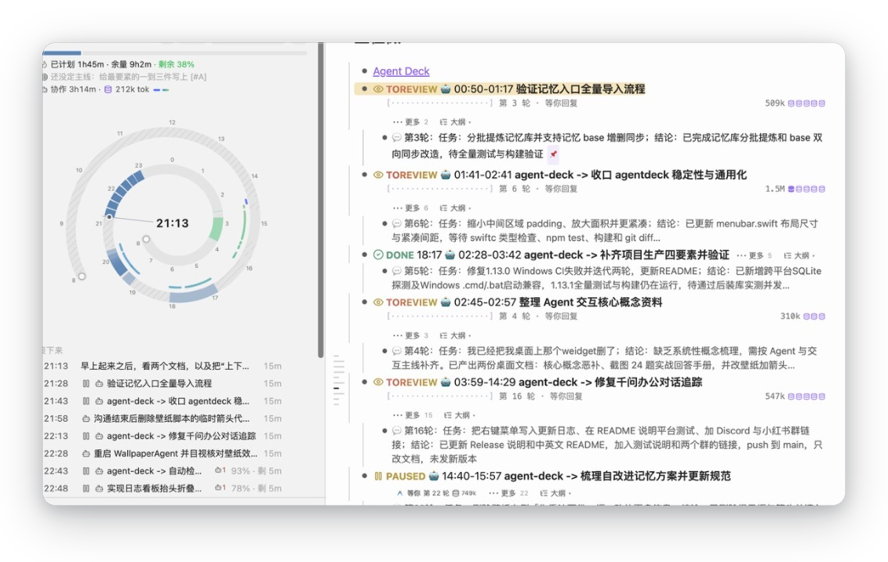
</p>

- **Automatic AI session logging**: Agent Deck writes sessions from Claude Code, Codex, WorkBuddy, DeepSeek Harness, and Antigravity into your daily note, keeping status, rounds, summaries, and completion up to date.
- **Inner-ring visualization**: Nautilus Spiral draws each agent's active spans on color-coded inner rings and summarizes collaboration time and token usage under the capacity bar.
- **Live status sync**: Spiral blocks and "Up next" rows reflect each agent's live state (running, to review, needs approval, queued, hit limit, errored), and clicking a task's AI badge opens the linked session details.
- **Shared day cutoff**: Both plugins share the same day boundary so late-night sessions stay grouped under the right day.

---

## Feedback & Updates

Planned features and requests live on the [Roadmap](https://matsuri.site/portfolio/journal-workflow/#wishlist)—feel free to suggest ideas or vote. You can also follow updates and share feedback on Twitter: [@Matsurimywaifu](https://x.com/Matsurimywaifu).

MIT License.
