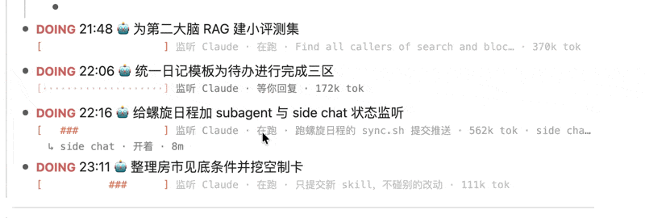

# 螺旋日程（Nautilus Spiral）

> **给每一分钟安排一份工作。**

一个读日记的 Obsidian 螺旋日计划。

[English](./README.md) · **简体中文** · [使用指南](./docs/guide.zh-CN.md)

  

把今天日记里的事件和待办画成一圈螺旋：固定事件钉在它的时刻上，待办按列表顺序和预计时长，从「现在」开始自动填进事件之间的空档。时间往前走，没做完的任务就跟着往后流；排不下的，当场告诉你缺多少。

50 秒看完它做什么（有声音）。片子里的面板是插件自己的代码按一篇虚构日记画出来的：

https://github.com/user-attachments/assets/1e0967bc-d498-456a-9d82-46750d761c08

插件默认只在三种时候改日记：你开始做一件事、你回答「做完了吗」、触发了暂停规则，每次都只改那几行的状态（DOING / DONE / PAUSED）。打开「自动记日记」或「实际时段写回日记」以后，还会替你写 Agent 会话的状态和任务下面的 `⏱` 那一行。日记照常用列表写，在 Obsidian 里写、在 Bike 里写、从 Telegram 记进来都行。打开设置后，macOS「日历」里的事件也会当固定事件排进来，▶ 还可以顺带开一段 Raycast 专注。

## 推荐：和 Agent Deck 一起用

[Agent Deck](https://github.com/MatsuriMW/obsidian-agent-deck) 是这套玩法的另一半，建议两个插件一起装：

| 插件 | 负责 |
|---|---|
| 螺旋日程 | 日记和日程本身：螺旋排程、计时、容量、复盘，以及 Agent 的追踪展示（内圈细线、状态栏、进度条、`🔗` 绑定） |
| Agent Deck | AI 写入那一半：自动记日记、状态写回、`💬`、桌面版子会话 / side chat / subagent 子块、归档 → `DONE`，以及从任务行委派 |

交接：在 Agent Deck 的 **设置 → 追踪 → 停用螺旋日程里的 AI 写入**，然后重新加载螺旋日程。螺旋只停 AI 写入，排程、螺旋和追踪展示照常；写日记交给 Agent Deck。不装 Agent Deck 时，下面的人机共写功能仍然由螺旋自己完成。

## 它能带来什么

- **一块往里卷的 12 小时表盘。** 最外圈是一天的开始，最里圈是结束。固定事件、排进去的待办、做完的任务和「现在」都在上面。鼠标划过哪一段，螺旋上方那一行立刻显示它是什么。
- **照着日记自己排。** 写 `14:00-15:30 开会` 是事件，写 `TODO 回邮件 20m` 是待办，`3点到5点`、`半小时` 这样的说法也认。插件每分钟重排一次，不用你拖来拖去。
- **记实际做了多久。** 任务是 `DOING` 的时候计时，改成 `DONE`、`PAUSED` 或改回 `TODO` 时停，中断再续就是好几段。当日复盘逐件对照预计和实际，近 30 天的复盘告诉你平时估得准不准。
- **时间记录写在日记里。** 实际做的时段写在任务下面一行：`⏱ 14:05–14:40、15:10–15:32 · 共 57m`。Agent 的会话由机器写，后面带上用掉的 token 和是哪个 Agent；你自己做的任务打开开关后也写。这一行是正本，你改它，螺旋跟着变。
- **看得见没记录的时间。** 已经过去、你和机器都没留下记录的时段，在螺旋上画成斜纹，另有一行告诉你今天到现在有多少时间是有记录的。
- **容量一眼看清。** 已计划多少，余量、超载还是空档不足，全天可安排的时间还剩百分之几；下面一行是可安排的时间和事件时间各自「现在还剩 / 全天」。状态栏里常驻一格：在做事时是计时，没在做时是同一句容量。
- **回放一整天。** 点一下，6 秒里「现在」从一天的开头扫到结尾，计划跟着重排。日记不会被改。
- **专注轮。** 开始一件任务时带上计时，愿意的话再带一段 Raycast Focus；也可以不选任务，只选一个大方向开一轮。
- **日历，只读。** macOS「日历」和 Google 日历（走 Google Calendar API，用你自己建的 OAuth 客户端）里的事件都可以当固定事件排进螺旋。两个可以同时开，同一件事只留一份。
- **小音效，两种情绪。** 点螺旋上的一段、列表里的一行，有一声轻的「嗒」；库里任何一篇笔记的任务状态一变也响一声，不管是谁改的（快捷键、任务插件、看板、手敲）。往前走的（`TODO`、`DOING`、`DONE`）音往上走，轻而不亮；停下来的、没成的（`PAUSED`、`WAITING`、`SUSPENDED`、`CANCELLED`、`FAILED`）音往下落，一个比一个低、一个比一个糙。全是现合成的，不带声音文件，一个开关就能关。
- **Agent 的时间。** 读 Claude Code、Codex（桌面版和命令行）、WorkBuddy、DeepSeek Harness 留在本机的会话日志，把每个 Agent 干活的时段画成内圈的细线，一个 Agent 一种颜色，带上各自消耗的 token（产出 + 读入，缓存命中单列）。四个里用哪几个你自己选，再挑一个主力：主力全量追踪（全部历史、跨天补记、状态栏），其余的只追踪今天有动静的会话。
- **正在做的那一行下面有一条进度。** 编辑器里 `DOING` 的那一行下面多一行等宽字符，像命令行那样用 `#` 填：`[#########-----------] 45%`。数取你写在这一行里的进度（`60%`、`2/3`）；没写就看对上的那个 Agent 会话，它自己列了待办就按做完几步算；再不然按已经做了多久和预计时长算。对上了会话，后面还写它在跑还是等你回复、最近一步在干什么、用了多少 token；会话对不上可以手动绑定（在任务下面写一行 `🔗`），会话归档了这一行自动走到 100% 并记成 `DONE`。
- **主动记录和被动记录结合。** 你有意记的：计划、预计时长、手动改的状态。机器在旁边替你记的：每个 Agent 会话真正在动的时段和时长。两种记录落在同一篇日记、同一圈螺旋上。
- **人机共写（可选，默认关）。** Agent 会话在动，日记里对应的那一行变成 `DOING`；40 分钟没动静变成 `PAUSED`（暂停），实际时段写在它下面。插件不自己判断 `DONE`；你在 Claude 桌面 app、Codex 或 DeepSeek Harness 里把会话归档，才算你说的做完了。装了 [Agent Deck](https://github.com/MatsuriMW/obsidian-agent-deck) 的话，推荐把写回这一半交给它，见上面的「推荐」。同一件事随时可以手动跑一次（`⌃⌥L`，或者「人机协作」旁边的按钮），自动的开没开着都行。
- **每周方向回顾。** 每个会话归到一个大方向，周日晚上给你这一周的分配。

## 用日志大纲和 Agent 一起干活

  

日记是一份大纲，一行任务对应一个 Agent 会话。螺旋日程把这份大纲变成 Agent 干活的仪表盘：谁在跑、谁在等你、各用了多少 token、最后说了什么，都写在任务自己那一行下面。

- **一行任务，一个会话。** 对上的办法有三种：任务下面有一行 `🔗`（绑定就写在正文里，这一块挪到哪、改了字都还认）；打开了自动记日记，机器替你对；或者会话的标题、你发的第一句话和这一行重名。命令「把这一行绑定到一个 Agent 会话…」手动写这一行 `🔗`。
- **并列的几行，就是同时在跑的几个 Agent。** 几行 `DOING` 各挂各的会话、各有一条进度；螺旋内圈一个 Agent 一种颜色，画出它们同时在干活的时段。
- **状态跟着会话走。** 在跑、等你回复、多久没动静，都是从会话日志里读的；会话停下来等你看，这一行自动改成 `TOREVIEW`，停在「允许吗？」上改成 `NEEDOK`，报错停了（过载、断网、上下文满了）改成 `ERRORED`，撞了用量限额改成 `HITLIMIT`、已经排进续跑队列的改成 `QUEUED`，又动起来改回 `DOING`。会话在 Claude 桌面 app 或 Codex 里归档了，这一行走到 100%，自动记成 `DONE`。
- **它最后说的话回到大纲里。** 任务下面有 `🔗` 的，会话每答完一轮，最后那条回复压成一行 `💬` 写在任务下面：做完时是结论，停下来问你时是它问的那一句。下一轮答完换成新的，完整的回复点 `🔗` 回会话里看。
- **会话派出去的 subagent、开着的 side chat 也看得见。** Claude Code 会话派了 subagent，进度条末尾多一截 `🤖 2 跑 1 完`，下面每个 subagent 一行：它的描述、在跑还是跑完了、最近一步、用了多少 token；在 Claude 桌面版里给这个会话开了 side chat，也各占一行（开着、开了多久）。会话每答完一轮，在 `💬` 下面再写一行 `🤖 子代理 3：查 runTmux ✓ 16k、查 cue() ✗ 停了 · side chat 1` 留档。数据都来自本机：subagent 的日志在会话目录的 `subagents/` 下；side chat 不落盘，只能看到桌面版为它起的那个 claude 进程，问了什么、在答还是等你、用了多少 token 都读不到。
- **会话里开出来的会话按层级挂成子块。** 在 Claude 桌面版里，绑着的会话又开出新会话（侧栏里挂在它下面的），新会话写成这件任务的子块，下面一行它自己的 `🔗`，状态、进度条、`💬` 都各跟各的；再往下开的接着往下挂，层级和侧栏一样。你事先列好的子任务对得上新会话的标题，就直接绑那一块。
- **状态栏报数。** 右下角一格 `🤖 2 在跑 · 1 等你`，点一下跳到等你的那一行。
- **记录留在大纲里，能追回去。** 做完的任务下面是一行 `⏱ 20:12–21:09 · 共 57m · 885k tok · Claude`，末尾的 Claude 是链接，点了回到那个会话。
- **发令交给配套的插件。** [块去向](https://github.com/MatsuriMW/Obsidian-Plugins/tree/main/done-to-top)的 `⌥⌘S` 把一块连同子块发给 Claude CLI：开会话之前就定好会话号，在这一行下面记下 `🔗`，进度条随后开始走。选中几块并列的再发，每块各开一个会话（并列 = 并发）；选「子块各开一个」，母块当共同背景，每个子块一个会话，结论回到各自的子块下面（纵深 = 子会话）。会话可以开在终端窗口里，也可以放在后台的 tmux 里，或者用 `claude -p` 无头跑。不装它也行，把任务原样贴给 Agent 当第一句话就能对上。

它现在不做的事：不调度，发出去的会话各跑各的，不排队、不重试、不管谁先谁后；写回来的只有最后一条回复压成的一行，Agent 改了哪些文件、完整的回复不进大纲；子会话的结论各回各的子块，不会替你汇总到母块上。`💬` 只在这篇笔记开着的时候写。

## 快速开始

这个插件是从作者自己的工作流里长出来的，功能多，但大部分是可选的。先照下面五步配好就能用，其余的用到哪个开哪个，见[使用指南](./docs/guide.zh-CN.md)。

1. **装上并启用。** 从 [Release](https://github.com/MatsuriMW/nautilus-spiral/releases/latest) 下载 `main.js`、`manifest.json`、`styles.css`，放进 `<库>/.obsidian/plugins/nautilus-spiral/`，在「第三方插件」里启用。用 BRAT 的话直接填这个仓库的地址。
2. **告诉它日记在哪。** 设置 → Nautilus Spiral：
   - 「日记文件夹」和「日记文件名格式」改成你自己的。格式是 moment.js 的写法，比如 `YYYY-MM-DD`；默认值 `日记/` 和 `YYYY_MM_DD` 是作者的习惯。
   - 「一天从几点开始 / 到几点结束 / 日记日期分界」按你的作息改。默认是早 8 点到次日早 8 点、08:00 前算前一天，这是给熬夜的人用的；正常作息可以改成 7、24、04:00 之类。日期分界按 24 小时制的时刻填，可以带分钟（`4:30`）。
3. **在今天的日记里写两行试试。** 每件事一个列表项，比如 `- 14:00-15:00 开会` 和 `- TODO 回邮件 20m`。写法见[使用指南](./docs/guide.zh-CN.md)的「日记里的写法」。
4. **打开螺旋。** 点左侧功能区的螺旋图标（orbit），或运行命令「打开螺旋日程」。
5. **做的时候改状态。** 开始做一件事改成 `DOING`，做完改成 `DONE`。也可以按 ⌘⇧↵ 开始，到点回答「做完了」，插件替你改。螺旋会随日记保存自动重画。

装上以后先看一眼这三处默认行为，不合适就改：

- **会改你日记的两条规则默认开着**：同时最多 3 件 `DOING`（再开一件，最早的那件被改成 `PAUSED`）；`DOING` 超过 3 小时没动也改成 `PAUSED`。在「硬规则」里把数字改成 0 就是关掉。
- **没装 Raycast 的**：把「同时开 Raycast 专注」关掉，否则每次开始做都会提示打不开。
- **启动行为**：默认每次启动 Obsidian 都打开今天的日记、把左侧栏切到螺旋。设置最下面可以关。

系统要求：只支持桌面端，在 macOS 上开发和使用。螺旋、排程和计时是纯 Obsidian 的；日历、对话框、提示音、专注提醒和游戏时间只有 macOS 有。Windows 和 Linux 没有测过。

## 可选执行层

规划之外想再往前一步，把「做」也管起来，用这四样，对应 Nautilus Log 里说的执行层。每一样都很小，可以放着不管；四样都不用，它仍然只是一圈螺旋和一列预计时长。

- **计时（Timing）**：任务是 `DOING` 的时候就在计时。右下角状态栏显示最近开始的那件做了多久、一共几件在做；连着做了 45 分钟计时变红，开了 2 小时提醒你检查，这两样都不替你停。`⌃⌥V` 看全貌。
- **计划（Plan）**：螺旋下面的列表。「接下来」是今天排进去的，按排到的先后列；「排不下」是今天放不下的。点 `▶` 或按 `⌘⇧↵` 开始一件。
- **复盘（Review）**：「📋 今日复盘」逐件对照这一天的预计和实际。只有做完、也记到了实际用时的才算进偏差，在做的、停着的照样列出来，但不影响那个数。「📏 预估 vs 实际」看的是近 30 天。
- **专注（POMO）**：`⌃⌥F` 开一轮只选大方向的专注。它只计时，不改日记里的任何一行；状态栏在这一轮里正计时。

和 Nautilus Log 的区别：这里没有一个总开关，也没有从顶栏弹出来的面板。四样分散在状态栏、列表和几个快捷键里，其中状态栏、当日复盘、预估复盘在设置里各有开关。

## 原理：给每一分钟安排一份工作

记账软件 YNAB 的方法是「给每一块钱安排一份工作」：钱进来先分到各个用途上，花的时候心里有底。螺旋日程把同样的办法用在时间上：

- **一天是一笔预算。** 从现在到收工的时间，扣掉已经定死的事件（吃饭、开会、通勤），剩下的就是今天能自由分配的分钟数，也就是容量条上的「可安排」。
- **每件待办都要先报价。** 写上预计时长（`30m`、`2h`），没写的按 15 分钟算。所有待办的报价加起来是「已计划」，和「可安排」一比，今天是有余量还是超载一眼就清楚。
- **时间是一条往前流的河。** 螺旋上的「现在」指针一直往前走，没做完的任务被它推着往后挪；遇到固定事件放不下，就整块跳到下一个空档，后面放得下的小任务自动往前补位。你不用手动改计划，插件每分钟重排一次。
- **规则简单，不靠 AI。** 事件先占位，正在做的排最前，其余按列表顺序依次找最早放得下的空档。想调整先后，在日记里上下挪一下那一行就行。

预计和实际是两回事，插件把两者分开记，也能放在一起看：

- **预计**是弹性推演：按你写的时长往前排，随时间重算，用来回答「今天还排得下吗、接下来做什么」。
- **实际**是事后的实证：任务改成 DOING 的那一刻开始计时，改回来或做完时停止，中断再继续就记成好几段。做完的任务按实际做的时段画在螺旋上，和当初的预计放在一起，一天下来哪件事估短了、哪段时间被打断了，都能看到。

「实际」这本账由谁来记，是螺旋日程自己往前做的一步：**人主动记，机器辅助着被动记，两种记录合在一起。**

- **主动记录**是你有意写下的：计划、预计时长、手动改的 DOING / DONE、开的每一轮专注。它带着你的意图和判断，缺点是人会忘，忙起来也懒得记。
- **被动记录**是机器在旁边替你留的：Claude、Codex、WorkBuddy、DeepSeek Harness 的会话日志本来就记着每一刻在不在干活，插件把它读出来画进螺旋，也可以写回日记（见[使用指南](./docs/guide.zh-CN.md)的「🤖 自动记日记」）。它不会漏，缺点是不知道这件事对你来说算不算做完。

所以两边各管各擅长的：状态和结论听人的，时段和用时交给机器。机器只做辅助，它不替你判断 DONE，你手动改过的行它也不再动。

## 灵感来源

这套模型不是原创。源头是捷克作家 Tomáš Baránek 给 Roam Research 写的 [Nautilus](https://github.com/tombarys/roam-depot-nautilus)（鹦鹉螺）：先读出当天定死的事件和每件任务的预计时长，再让任务按列表顺序填进事件之间的空档。「现在」的指针往后走，没做完的任务跟着整体后退；碰上固定事件放不下，就整块跳到下一个空档，后面放得下的任务自动往前补位。整套规则是确定的，排程这件事不需要 AI。

它有力量的地方，在于让每一段时间都有了着落。记账软件 YNAB 的口号是 Give every dollar a job，[Nautilus Log](https://github.com/404KSG/roam-nautilus-log)（在 Roam 上对 Nautilus 的一次重构）把它改成了 **Give every minute a job**：

- **先分配，再花。** 给每件事报一个时长，等于把今天的时间当成预算分出去。事情再多，也是在一笔看得见的预算里安排，超支了当场知道。
- **任务自己走到你面前。** 时间往前推，能做的任务被自动拉到「现在」跟前。你不用反复判断这会儿该做哪件，也不用担心临时插进来的事打乱后面的节奏，分配过预算的任务都会在螺旋上找到自己的位置。
- **预计和实际是两本账。** Nautilus Log 在规划之外加了 Org mode 式的 Logbook：螺旋是按预计时长做的弹性推演，Logbook 是对实际用时更严格的实证，两者可以并存，也可以只用一个。

背后的想法是：时间是一条真实流动的河。留不住它，但可以理解它、规划它、从容地用它。

螺旋日程沿着这条线又走了一步：把「实际」那本账的一部分交给机器来记（上一节说的主动记录和被动记录），数据源也从专门的组件换成了日记本身。和这几个项目的关系、代码上的区别，见文末的致谢。

## 联网、账号和库外文件

不打开下面这几项可选功能，就没有任何东西离开你的电脑。没有遥测，也没有要付费的地方。

| 发出去的是什么 | 什么时候 | 发到哪 |
|---|---|---|
| 会话标题、你最近说的几句、最后一条回复的结尾、日记里没做完的任务行 | 只在打开「自动记日记」后，出现新会话或者某个会话停下来时 | 本机的一个命令行，用它自己的登录：装了 `claude` 就用它（Anthropic），没有就用 `codex`（OpenAI），设置里可以指定。12 位以上的连续数字会先抹掉 |
| 每周方向回顾（文字）；你从手机上要的螺旋图 | 只在装了并配好 Telegram Companion 时 | Telegram Bot API，经你自己的机器人。机器人的 token 从 Telegram Companion 的设置里读，本插件不存 |
| 提醒，里面有任务名 | 只在填了 Discord 频道时 | 你本机的 `notify-discord` 脚本，以及它拿着的 webhook |
| 读日历列表和当天事件的请求；不往日历里写任何东西 | 只在打开「读 Google 日历」并连接了账号时 | Google：`accounts.google.com`（你在浏览器里登录、同意）、`oauth2.googleapis.com`（令牌）、`www.googleapis.com`（Calendar API）。申请的权限只有 `calendar.readonly`，用的是你在自己的 Google Cloud 项目里建的「桌面应用」OAuth 客户端，插件不带任何公共的密钥 |

Google 日历需要一个 Google 账号。客户端密钥和刷新令牌存在 Obsidian 的密钥存储（系统钥匙串）里，不写进插件的 `data.json`；老版本 Obsidian 没有密钥存储时才退回 `data.json`。连接的那一会儿，插件在 `127.0.0.1` 的一个随机端口上等浏览器把授权码送回来，收到就关，最多等五分钟。

**读库外的文件**，都是只读，而且只读设置里开着的那几个 Agent（不是主力的只读今天改过的会话文件）：`~/.claude/projects`、`~/.config/claude/projects` 和 Claude 桌面 app 的 `claude-code-sessions` 文件夹（看哪些会话归档了、哪个会话是从哪个会话开出来的）；另外看一眼本机进程列表，认出 side chat 的 claude 进程；`~/.codex/sessions`、`~/.codex/archived_sessions` 和 `~/.codex/session_index.jsonl`（会话标题）；`~/.workbuddy/projects`。每天的汇总存在插件目录的 `ai-usage.json` 里。

**写库外的文件**：`~/Library/Caches/nautilus-spiral/`，是第一次用到时在本机编出来的几个 Swift 小助手（读日历用的，和一个试验性的通知 App）。

**会启动的本机程序**：`osascript`（对话框）、`swiftc` 和 `codesign`（编小助手）、`afplay`（提示音）、`open`（Raycast 链接、把 Obsidian 叫到前面）、`ps` 和 `sh`（游戏时间）；打开自动记日记后还有 `claude` 或 `codex`，以及找不到 `codex` 时问一次你的登录 shell。

## 致谢

- Tomáš Baránek 的 [Nautilus](https://github.com/tombarys/roam-depot-nautilus)：最初的螺旋日计划。
- 它的后续 [Nautilus Enhanced](https://github.com/hopeserena/nautilus-enhanced) 和 [Nautilus Log](https://github.com/404KSG/roam-nautilus-log)：「给每一分钟安排一份工作」，以及规划之外的执行层。
- 时间预算的想法来自 [YNAB Method](https://www.ynab.com/the-four-rules/)；本插件和 YNAB 没有关联。
- Obsidian 上已经有两个同一条线的移植：[Nautilus Log](https://github.com/accessiblefish/obsidian-nautilus-log) 和 [Nautilus Logger](https://github.com/dimpurr/obsidian-nautilus-logger)。

这个插件用的是它们的想法，不是代码。容量条上的数字、斜纹画出的没记录的时间、当日复盘、空档悬停、状态栏计时和回放，判定规则照 Nautilus Log（MIT），为的是同一个数字是同一个意思；代码是在 Obsidian 里重新写的，并且拿它的 `log-core.js`、`timing-core.js` 逐项对过。它是为另一种工作流单独写的：日记本身就是数据源，用普通列表加 Logseq 式的任务关键词来写，Agent 的会话日志当作「实际发生了什么」的证据。

MIT 许可。
