<div align="center">

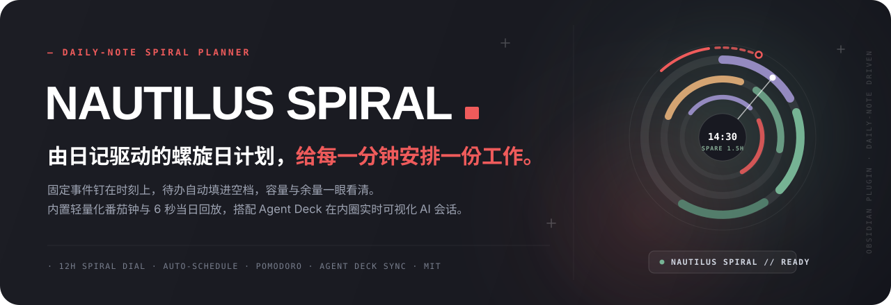

<br />

[English](README.md) · **简体中文**

[](LICENSE)
[](https://github.com/MatsuriMW/nautilus-spiral/releases)

[**安装插件**](#快速开始安装与使用) · [What's New](#whats-new) · [使用指南](./docs/guide.zh-CN.md) · [与 Agent Deck 联动](#与-agent-deck-联动) · [Roadmap](https://matsuri.site/portfolio/journal-workflow/#wishlist) · [X (@Matsurimywaifu)](https://x.com/Matsurimywaifu)

</div>

<p align="center">
  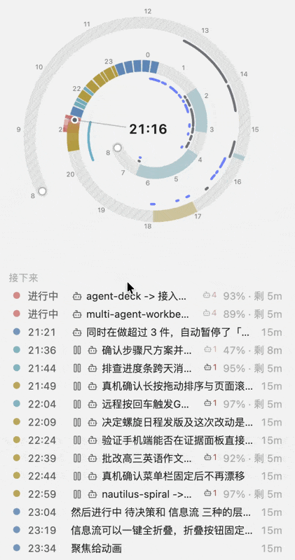
</p>

把今天日记里的事件和待办画成一圈螺旋：固定事件钉在它的时刻上，待办按顺序和预计时长，从「现在」开始自动填进空档。时间往前走，没做完的任务跟着往后流；排不下的，当场告诉你缺多少。

50 秒看完它做什么（有声音）：

https://github.com/user-attachments/assets/1e0967bc-d498-456a-9d82-46750d761c08

界面跟着 Obsidian 的语言自动切换中文或英文。

## 目录

- [What's New](#whats-new)
- [它有什么功能](#它有什么功能)
- [快速开始：安装与使用](#快速开始安装与使用)
- [与 Agent Deck 联动](#与-agent-deck-联动)
- [反馈与后续](#反馈与后续)

---

## What's New

近期版本（v2.6.8–v2.6.19）新增了**螺旋外圈引导标签**、**悬停联动高亮与未记录时段查看**、**紧凑顶栏作息与标签开关**、**日记内嵌只读螺旋图**（`nautilus-spiral` 代码块）、**四页重组设置**、**中英双语示例与使用指南**，以及全新的**六维螺旋复盘面板**（支持日 / 周 / 月视角）。

- **外圈引导标签与自适应避让**：支持双行详情卡片与沿轮廓排布的紧凑单行标签，密集日程下自动错开防遮挡；底部时段自动向下引出标注，避免拥挤。
- **悬停联动与顶部详情条**：鼠标移到任意任务弧段或未记录斜纹区时，同步高亮弧段与实线引导线，并在顶部直接展示完整时段、用时与项目标题。
- **一体化侧栏与六维螺旋复盘**：顶栏集成作息预设菜单与标签显隐切换，容量区汇总人机协作时长与 Token 消耗；复盘面板覆盖预估准确度、主线兑现、人机并行杠杆、时间账单、近 8 周预估趋势、24 小时节律热力图与跨天卡壳清单，支持一键写入日记或交给主力 Agent 复盘。

<table>
  <tr>
    <td align="center" width="50%">
      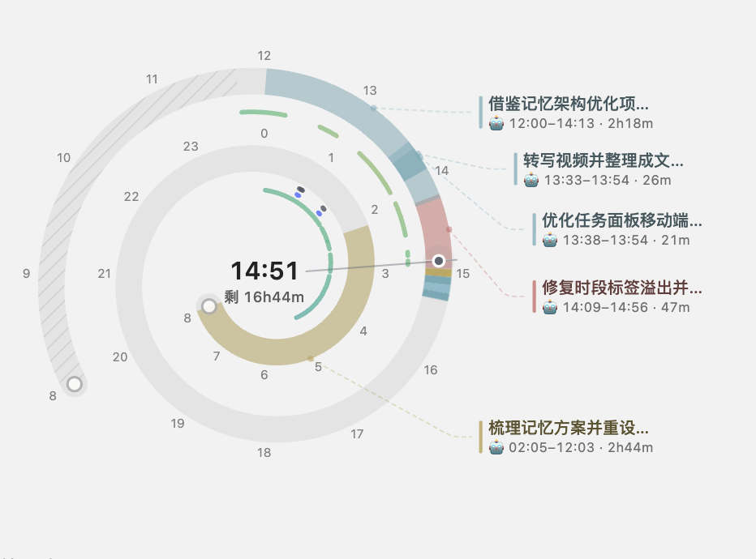
      <br />
      <sub><b>双行外圈标签卡片</b> — 一眼看清起止时段、总用时与状态色</sub>
    </td>
    <td align="center" width="50%">
      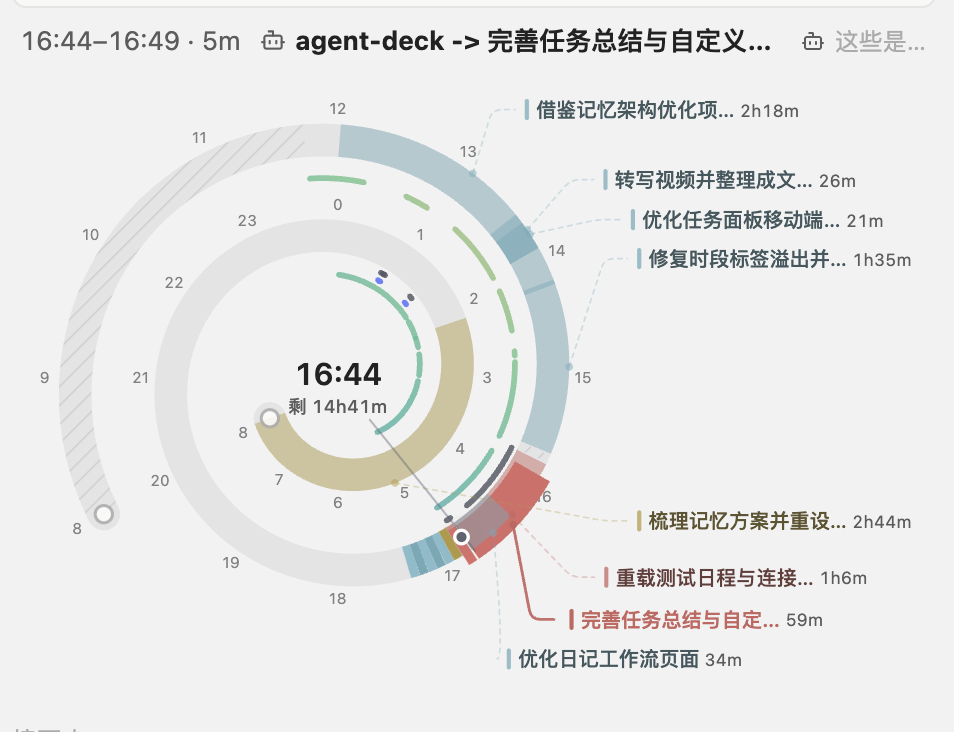
      <br />
      <sub><b>悬停联动高亮</b> — 高亮当前弧段与实线引线，顶部同步显示详情</sub>
    </td>
  </tr>
  <tr>
    <td align="center" width="50%">
      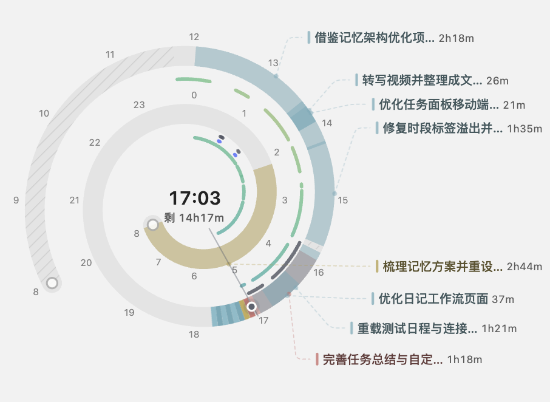
      <br />
      <sub><b>沿轮廓紧凑排布</b> — 多会话密集日也能整齐错开、不重叠</sub>
    </td>
    <td align="center" width="50%">
      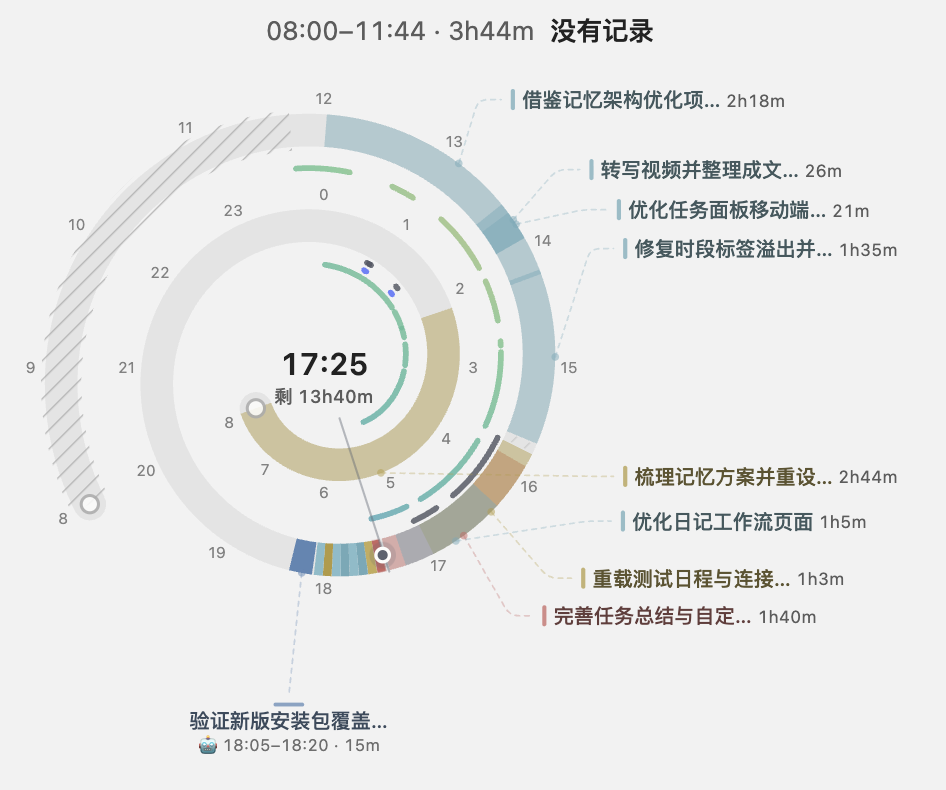
      <br />
      <sub><b>未记录时段查看与底部自适应标注</b> — 底部弧段自动向下引出标签</sub>
    </td>
  </tr>
</table>

<p align="center">
  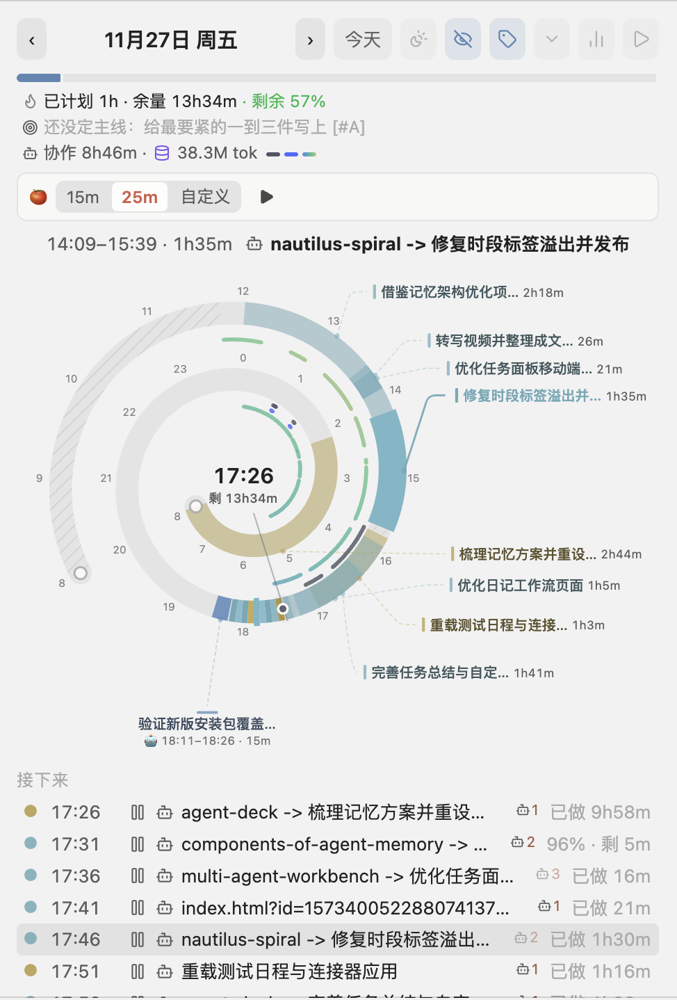
</p>
<p align="center"><b>新版侧栏全景</b> — 紧凑作息与标签开关、AI 协作时长与 Token 汇总、番茄钟与「接下来」任务列表。</p>

<p align="center">
  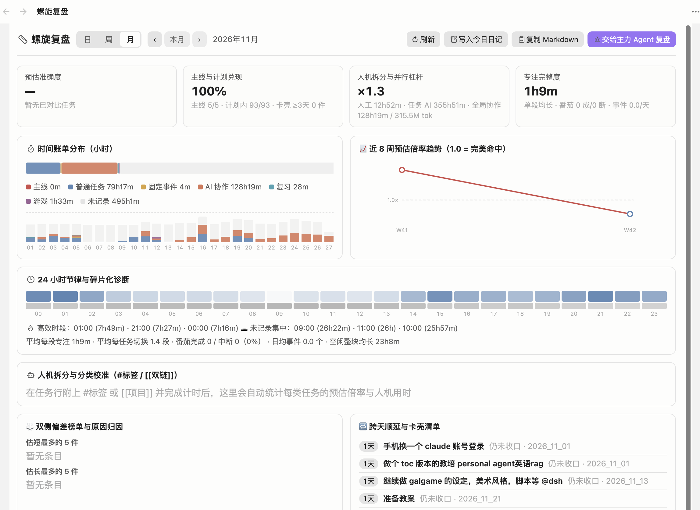
</p>
<p align="center"><b>六维螺旋复盘</b> — 日 / 周 / 月维度统计时间账单、近 8 周预估校准趋势、24 小时节律与人机并行杠杆，支持一键写入日记或交给主力 Agent 复盘。</p>

---

## 它有什么功能

### 螺旋日计划与容量一眼看清
- **12 小时螺旋表盘**：最外圈是一天的开始，最里圈是结束。固定事件、排进去的待办、已完成的任务和「现在」指针都在上面，鼠标划过即看详情。
- **自动排程与容量预算**：在日记里写时间和待办，插件自动把待办填进事件之间的空档，并实时算出已计划时长、余量 / 超载与剩余百分比。
- **主线任务（`[#A]`）与优先级小方块**：每天最多标记 3 块主线，优先排程、独立着色，并在顶部一眼看清完成进度；任务里的 `[#A]` / `[#B]` / `[#C]`（以及 `todo a`、`todoa`、`[ ] b`、`DOING 14:05 a`、`todos:` 下 `- a` 等模糊简写）会在离开该行时自动规范化，并在编辑器与螺旋面板渲染为红 `A` / 黄 `B` / 蓝 `C` 彩色小方块。
- **未记录时间与一键回放**：已经过去但没留下记录的时段以斜纹标出；点顶部播放按钮可在 6 秒内回放一整天的推进过程。
- **自动计时与复盘**：任务切到 `DOING` 自动计时，支持当日复盘（预计 vs 实际）与近 30 天预估校准，右下角状态栏常驻显示当前计时或容量。
- **只读日历同步**：可选接入 macOS 日历或 Google 日历，将日历日程作为固定事件自动排入螺旋。
- **柔和动效与状态音效**：点击交互与任务状态切换配有轻柔合成音效（可在设置中关闭）。

### 番茄钟与「接下来」快捷操作
- **轻量化番茄钟（`15m` / `25m` / `自定义`）**：在「今天」的容量区下方切换三档时长，点击播放图标即可开启——支持独立预订、自动绑定当前进行中的人工 `DOING` 任务，或在列表 / 螺旋任务色块右键（番茄钟入口位于菜单顶部，可选默认档位、「按预估开始」或快速 `25m`/`15m`，进行中任务支持直接结束）与编辑器光标命令绑定任务；右键固定事件行或色块还可启动不改写日记的独立番茄钟；到点或中途满 1 分钟结束会自动将实际起止时段和总用时写回任务子块 `- ⏱ HH:MM–HH:MM · 共 Xm`，切换任务或手动改状态也会自动结算，直接参与每日复盘与比对。
- **螺旋外沿可视化预订**：进行中的番茄钟画在主轨外沿，**已兑现部分画实线、尚未实现的预订部分画虚线并在预计结束处标空心圆点**，不挤占原有排程，左键或右键外沿弧线可直接定位或结束任务；完成的轮次以淡色细弧留痕。
- **「接下来」快速切状态与重要程度**：左键点状态圆点可在 `DONE → SUSPENDED → 原状态` 间一键循环；在「接下来 / 主线 / 排不下 / 搁置」中右键任务行，或在螺旋上右键未完成任务色块，均可直接用番茄钟开始 / 结束、切换人工状态（`TODO` / `DOING` / `DONE` / `PAUSED` / `WAITING` / `SUSPENDED` / `CANCELLED`）或设置重要程度（`[#A]` / `[#B]` / `[#C]` / 清除）。

<p align="center">
  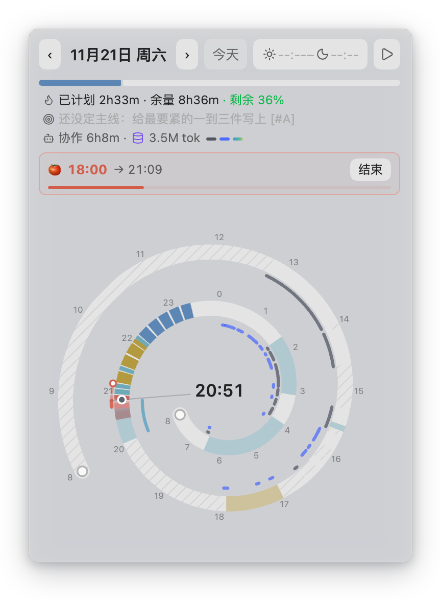
  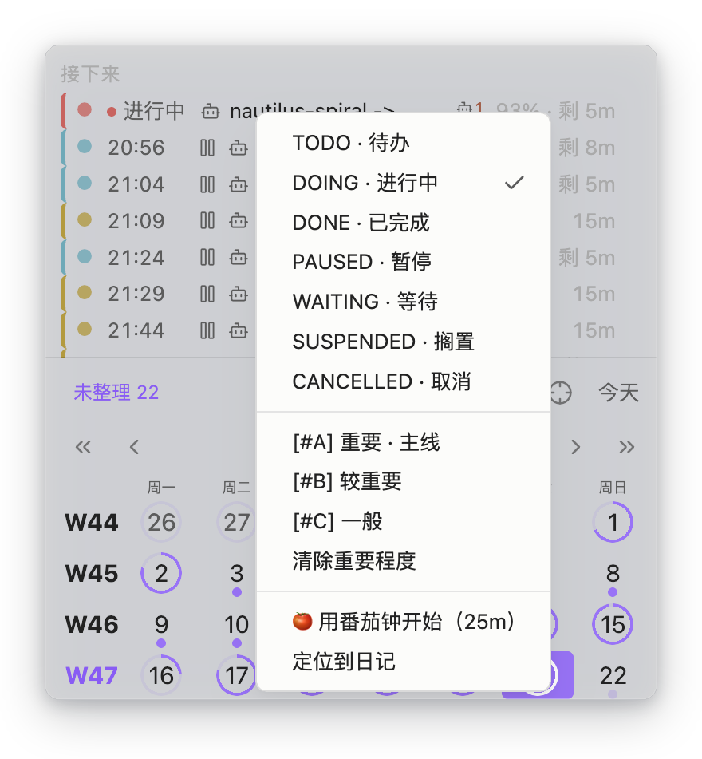
</p>

番茄钟计时、分段实际用时写回与每日复盘演示（中文字幕）：

https://github.com/user-attachments/assets/5d0b1f2a-335b-49c9-8504-fa37d5e4a60c

---

## 快速开始：安装与使用

### 1. 安装
- **社区市场 / BRAT**：在 Obsidian 插件市场搜索 **Nautilus Spiral**，或通过 BRAT 添加仓库 `MatsuriMW/nautilus-spiral` 安装并启用。
- **手动安装**：从 [Releases](https://github.com/MatsuriMW/nautilus-spiral/releases/latest) 下载 `main.js`、`manifest.json`、`styles.css`，放入库的 `.obsidian/plugins/nautilus-spiral/` 目录并在 Obsidian 设置中启用。

### 2. 开箱即用
- 首次启用（以及升级到新版）时，插件会自动在**左侧栏**打开螺旋视图，并创建且打开一份中英双语示例与使用指南笔记（`Nautilus Spiral/螺旋日程示例 - Nautilus Spiral Guide.md`），内含可复制练习日程、与 Agent Deck 联动用法及近期新功能速览；之后随时可在命令面板运行「打开螺旋日程示例与使用指南」重开。
- 插件会自动识别 Obsidian 的「日记」目录与日期格式（如需自定义，可在插件设置里手动修改）。
- 如果今天还没有日记，打开螺旋面板时会按你的设置引导或自动为你建好。

### 3. 在今天的日记里这样写
直接用普通列表记录事件和待办，螺旋会实时跟着更新：

```markdown
- 14:00-15:00 团队周会
- TODO [#A] 完成方案初稿 45m
- TODO 回复邮件 15m
- DOING 整理需求文档 30m
```

- **固定事件**：写上时间段（如 `14:00-15:00` 或 `下午3点到4点`）就会钉在对应位置。
- **待办与时长**：用 `TODO` / `DOING` / `DONE`（或复选框 `[ ]` / `[/]` / `[x]`），写上预计时长（`15m`、`半小时`、`1.5h`）；没写时按默认时长估算。
- **标记主线**：给最要紧的 1–3 件事加上 `[#A]`（或简写 `todo a`），也可以在「接下来」列表里右键设置重要程度。
- **随时微调当天作息**：拖动螺旋两端的空心圆把手，或点击顶部日夜小图标调整这天的起床与收工、切换作息或自定义预设；预设只是默认值，更早或更晚的记录会自动扩展螺旋。

> 所有命令均不预设全局快捷键，需要时可在 Obsidian「设置 → 快捷键」中搜索「螺旋日程」自行绑定。更多细节请参阅 [使用指南](./docs/guide.zh-CN.md)。

---

## 与 Agent Deck 联动

只装螺旋日程就是一套完整的个人日程与番茄钟工具；再装上 [Agent Deck](https://github.com/MatsuriMW/obsidian-agent-deck) 后，你的日记大纲会变成所有 AI Agent 的统一工作台：

<p align="center">
  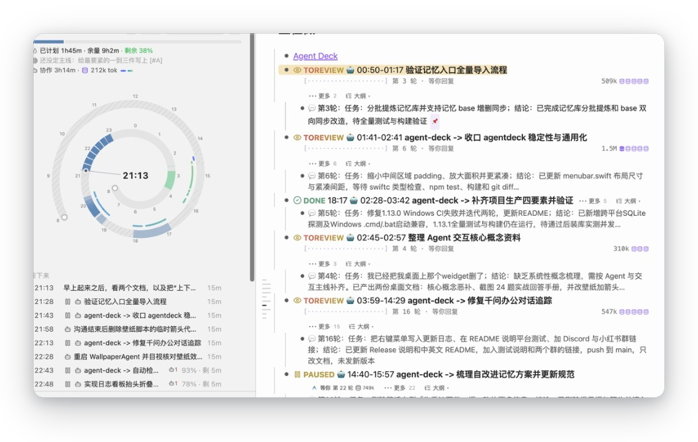
</p>

- **自动记录 AI 工作轨迹**：Agent Deck 负责把 Claude Code、Codex、WorkBuddy、DeepSeek Harness、Antigravity 等会话自动写进日记，更新运行状态、对话轮次、结论摘要和归档完成。
- **螺旋内圈可视化呈现**：螺旋日程把各个 Agent 的活跃时段按不同颜色画在螺旋内圈，在容量区汇总人机协作时长与 token 消耗。
- **状态色实时同步**：螺旋块与「接下来」列表会自动同步 Agent 的实时状态（运行中、待检视、等你允许、排队、限额、出错），点开任务旁的 AI 徽章可直接查看关联会话并跳转回去。
- **同一套日界标准**：两者共用螺旋日程的每日分界时间，深夜加班的会话也能准确归入当天。

---

## 反馈与后续

后续规划与功能需求整理在 [Roadmap](https://matsuri.site/portfolio/journal-workflow/#wishlist)，欢迎提出建议或为你想要的功能投票。也可以在 Twitter 上关注进展与反馈问题：[@Matsurimywaifu](https://x.com/Matsurimywaifu)。

MIT License.
